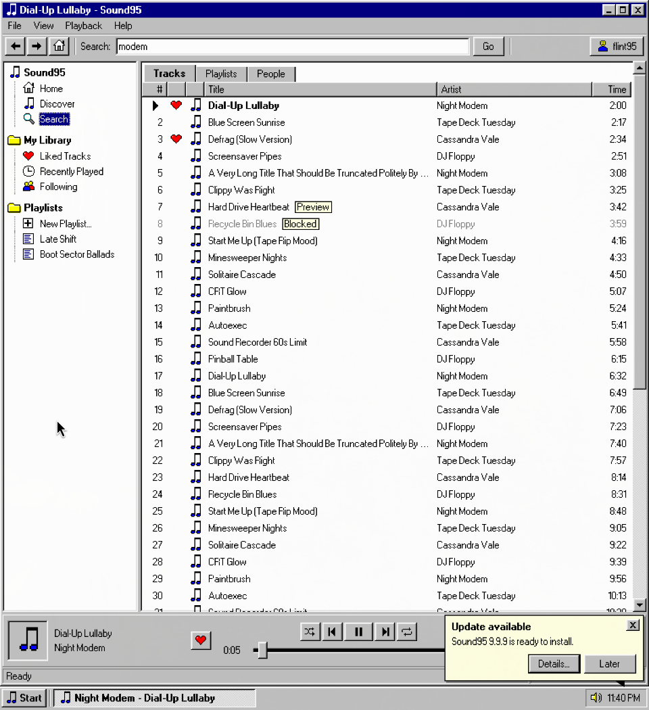

# Sound95

A Windows 95 style desktop client for SoundCloud, laid out like Spotify: library
tree, main pane, Up Next queue and a bottom player bar. Prefer today's look? The Modern
themes swap the 1995 chrome for rounded cards and smooth animations. Built with Tauri 2, Rust and
plain JavaScript, with no frontend build step.



## Install

Get the latest build from [Releases](https://github.com/FO4AN/sound95/releases/latest).

**Windows 10 or 11 (64-bit):** download `Sound95_*_x64-setup.exe` and run it. It installs
for your user only, so it doesn't need administrator rights. The installer isn't code
signed yet, so SmartScreen may warn you: choose **More info**, then **Run anyway**.

**Linux (x86-64):** this installs the app and a menu entry, with no root needed. It needs
glibc 2.35 or newer: Ubuntu 22.04, Debian 12, Fedora 36 or later. Older systems, such as
RHEL 9, aren't supported.

```bash
curl -fsSL https://github.com/FO4AN/sound95/releases/latest/download/install-linux.sh | bash
```

There's also a `.deb` for Debian and Ubuntu, and you can run the `.AppImage` directly.

Click **Log In** and sign in on SoundCloud's own page, in the window that opens. There's
nothing else to set up. Your likes, playlists and follows live on SoundCloud, so they
sync everywhere.

## Updates

Sound95 checks this repository's releases when it starts and every six hours. When
there's a newer version, a notice appears above the taskbar: **Details...** shows what
changed and **Update Now** installs it and restarts the app. **Help > Check for Updates**
does the same on demand. Releases are signed, and an update that doesn't match the key
built into the app is refused.

## Features

- **Track pages.** Click a track's name or picture for its page: waveform, details, lyrics
  and related tracks, all inside the app.
- **Visualizer.** Eleven modes: Spectrum, Oscilloscope, Mystify, Starfield, VU Meters, Waterfall,
  Sunburst, Plasma, 3D Pipes, Flying Windows and Marquee, driven by the audio that's actually
  playing. There's a small meter in the player bar too. Double click to fill the window. The bars
  stand lower in quiet passages and when you turn the volume down; Settings can turn that off.
- **Karaoke.** Finds lyrics for whatever plays and wipes through them in time. `[` moves the
  words earlier and `]` later. If a song only has plain text, the timing is a guess, and **Tap to
  Sync** lets you fix it: press Space as each line starts and it's saved for that track.
  **Paste Lyrics** covers songs nobody has published words for.
- **Likes.** The heart opens the track's SoundCloud page in a small window. Click Like there and
  the heart updates and the window closes by itself. SoundCloud's bot check turns away likes sent
  directly by apps, so they have to come from its own page.
- **Any window size.** The layout folds down to fit a small window or a tiling tile.
- **Looks.** Eight Windows 95 schemes (Light, Dark, Desert, Eggplant, Rainy Day, Rose, Spruce and
  High Contrast) and two Modern ones, dark and light. The first time you log on, a welcome lets
  you try them all before you start. File > Settings changes it later.
- **Animations.** The Modern themes open, close and switch things with smooth animations, at
  Slow, Normal or Fast. Settings can turn them off, and they start off if your system asks for
  reduced motion. The Windows 95 themes stay instant, like the real thing.
- **Your own background.** Settings > Background puts a picture, GIF or video behind the app,
  optionally blurred. With **Move with the music** a GIF or video plays faster when the music is
  loud, stops when it pauses, and everything pulses with the bass. The file stays on your
  computer.
- **Language.** English, Русский, Українська, Español, Deutsch or Français.
- **Discord.** Settings can show what you're listening to on your Discord profile. It's off until
  you turn it on.
- **Tray.** Closing the window keeps the music playing. Right click the tray icon to pause, skip
  or go back, and use Quit or File > Exit to really leave. Settings can turn this off.

## Build

Needs Rust. On Linux you also need the WebKitGTK 4.1 development packages. On Windows
you need the Visual Studio C++ build tools.

```bash
cd src-tauri
cargo build --release           # target/release/sound95
npx @tauri-apps/cli@2 build     # installers
```

The frontend in `dist/` is embedded at compile time, so rebuild after changing it.

## Releasing

Bump the version in `src-tauri/Cargo.toml` and `src-tauri/tauri.conf.json`, then push an
annotated tag. Its message becomes the release notes that the update dialog shows.

```bash
git tag -a v0.5.0 -m "What changed" && git push origin v0.5.0
```

The Release workflow builds both installers on GitHub, signs them with the
`TAURI_SIGNING_PRIVATE_KEY` secret and publishes them together once the tests pass. If the
tests fail, the release stays a draft that the updater can't see. Keep a copy of that key:
without it, installed copies can't update to a new build.

Both builds add their entries to the release's `latest.json`, which every installed copy
reads, and one can overwrite the other's. `tools/check-latest-json.sh` keeps the release a
draft unless that file offers the tag's version to Windows and Linux with the right
signatures. If it says a platform is missing, re-run that platform's build job.

The Linux build runs on Ubuntu 22.04, because the AppImage uses the system's glibc and so
needs at least the one it was built on. `tools/check-glibc.sh` fails the release if that
creeps up, and `tools/install-linux.sh` checks for it too.

## How it works

- `src-tauri/src/login.rs`: opens SoundCloud's sign-in page in its own window and keeps
  the session it leaves behind. Sessions last about a day, so it renews them by loading
  the website out of sight. The page can't call the app, and no client ID or secret is
  involved.
- `src-tauri/src/client.rs`: API client. Holds the session and keeps requests on the API
  origin. It talks to api-v2, the website's API, because the public API answers website
  sessions with 403.
- `dist/js/api.js`: the only frontend file that knows api-v2's paths and shapes.
- `src-tauri/src/lyrics.rs`: finds lyrics. LRCLIB and NetEase have timing, and Genius has
  the words when they don't. It works out the artist and song from messy titles, checks
  each result against the track's name and length, and scales the timing of sped-up
  uploads. Hosts are fixed in the code and no SoundCloud session is sent to them.
- `src-tauri/src/visual.rs`: turns the app's own audio into frequency bands, because the
  page can't read SoundCloud's player. `capture_linux.rs` taps this app's streams through
  PipeWire (`pw-record`) and reads the output device's delay, about 300 ms on Bluetooth, so
  words and bars match what you hear. `capture_windows.rs` uses WASAPI process loopback,
  which needs Windows 10 2004 or later. Neither opens a microphone, though a desktop that
  flags any audio capture may show a recording icon. Without either, the visualizer follows
  the track's published loudness and says so in its status bar.
- `src-tauri/src/update.rs`, `dist/js/updates.js`: the update check, notice and installer.
- `dist/js/player.js`: plays through SoundCloud's official
  [Widget](https://developers.soundcloud.com/docs/api/html5-widget), so listeners stream
  directly and don't use the app's stream limit. The player bar controls it.
- `dist/js/themes.js`, `dist/win95.css`, `dist/modern.css`: the colour schemes and the two
  skins. Modern restyles the same page, so every feature works in both.
- `dist/js/backdrop.js`, `dist/js/gif.js`: the background. GIFs are decoded in the app so
  their speed can follow the music, which an `` can't do.
- `dist/js/`: the rest of the UI.

## Testing

```bash
cd src-tauri && cargo test
cd .. && node tools/check-gif.mjs   # GIF decoder against ImageMagick's frames
OUT=/tmp/s95 tools/e2e.sh   # needs a debug build
```

`tools/mock-soundcloud.mjs` stands in for SoundCloud, including its sign-in page, and
`tools/e2e.sh` drives the real app against it. The test hooks only exist in debug builds.
CI runs the tests on Linux and Windows, and the app test on Windows.

## SoundCloud API terms

The [API terms](https://developers.soundcloud.com/docs/api/terms-of-use) ban "alternative
digital content services" and copying SoundCloud's overall experience, as well as
downloads and offline listening. Sound95 credits uploaders, links back to SoundCloud and
stores no audio. Lyrics are fetched when you ask for them and belong to their writers;
NetEase's and Genius's endpoints are undocumented too. It uses your own website session and the website's undocumented API
rather than a registered app, which SoundCloud doesn't support, so a change on their side
could break it without warning.
